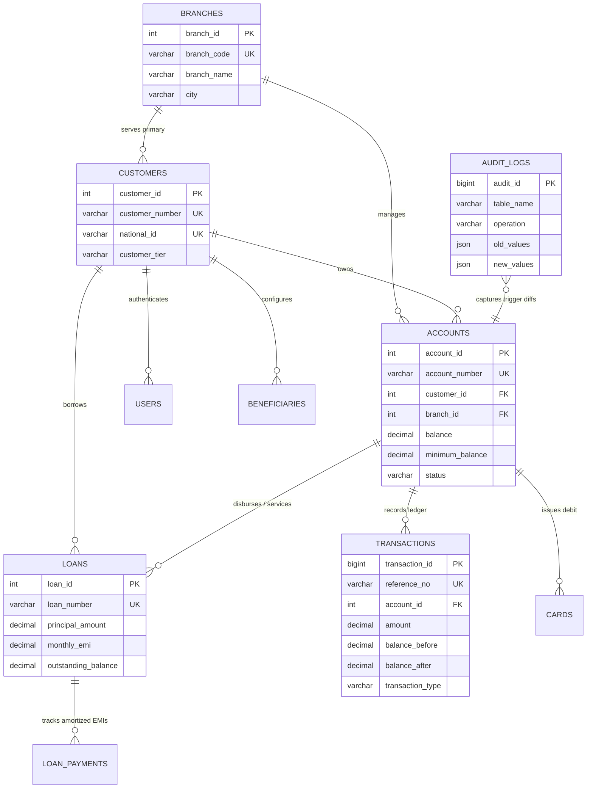
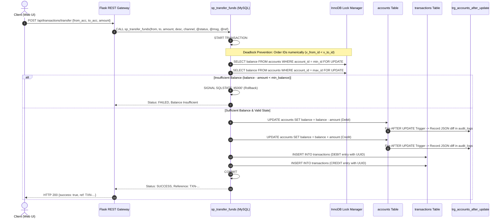

# 🏛️ NovaBank Database Architecture & Data Dictionary

> **DBMS Core Specification & Transaction Lifecycle Manual**  
> **Engine:** MySQL 8.x / 9.x InnoDB Storage Engine (`utf8mb4`)  
> **Currency Standard:** Indian Rupee (`₹` / INR)  
> **Design Philosophy:** Database-First Architecture (Stored Procedures, Triggers, Views, Constraints)

---

## 📑 Table of Contents
1. [System Architectural Overview](#1-system-architectural-overview)
2. [Relational Entity-Relationship Diagram](#2-relational-entity-relationship-diagram)
3. [Comprehensive Data Dictionary (11 Base Tables)](#3-comprehensive-data-dictionary-11-base-tables)
4. [Transaction Lifecycle & Concurrency Engineering](#4-transaction-lifecycle--concurrency-engineering)
   - [Atomic Fund Transfer (`sp_transfer_funds`)](#41-atomic-fund-transfer-sp_transfer_funds)
   - [Cash Deposit & Withdrawal (`sp_deposit_funds` & `sp_withdraw_funds`)](#42-cash-deposit--withdrawal)
   - [Account Origination (`sp_open_account`)](#43-account-origination-sp_open_account)
   - [Loan Origination & Amortization (`sp_apply_loan` & `sp_pay_loan_installment`)](#44-loan-origination--amortization)
   - [Batch Cursor Interest Accrual (`sp_monthly_interest_accrual`)](#45-batch-cursor-interest-accrual)
5. [Triggers & Autonomous Audit Trails](#5-triggers--autonomous-audit-trails)
6. [Analytical & Compliance Views](#6-analytical--compliance-views)

---

## 1. System Architectural Overview

NovaBank implements a **thick database, thin application layer** paradigm. Financial invariants, referential integrity, concurrency controls, and audit journaling are enforced directly inside the MySQL storage engine via ACID transactions, row-level locks, triggers, and stored procedures. The Flask web application acts strictly as an API gateway that translates HTTP JSON requests into parameterized SQL procedure calls.

```
+-------------------------------------------------------------+
|               Client Browser (Light Minimal UI)             |
|       Instrument Serif • Plus Jakarta Sans • JetBrains Mono |
+-------------------------------------------------------------+
                              │  JSON REST (fetch)
                              ▼
+-------------------------------------------------------------+
|              Thin Backend Layer (Python / Flask)            |
|       Connection Pool • No Business Logic • Parameterized   |
+-------------------------------------------------------------+
                              │  MySQL Protocol (port 3306)
                              ▼
+-------------------------------------------------------------+
|              MySQL 8.x InnoDB Database Engine               |
|  ┌───────────────────┐ ┌────────────────┐ ┌───────────────┐ |
|  | Stored Procedures | | Row-Level Lock | | Triggers &    | |
|  | (sp_transfer,...) | | (FOR UPDATE)   | | Audit Logs    | |
|  └───────────────────┘ └────────────────┘ └───────────────┘ |
|  ┌───────────────────┐ ┌────────────────┐ ┌───────────────┐ |
|  | 11 Relational     | | 6 Analytical   | | InnoDB MVCC & | |
|  | Tables (BCNF)     | | Reporting Views| | Write-Ahead Log |
|  └───────────────────┘ └────────────────┘ └───────────────┘ |
+-------------------------------------------------------------+
```

---

## 2. Relational Entity-Relationship Diagram



---

## 3. Comprehensive Data Dictionary (11 Base Tables)

### 3.1 `branches` (Bank Physical Metro Hubs)
Stores geographic banking hubs. Normalizes address data out of individual accounts to satisfy Boyce-Codd Normal Form (BCNF).

| Column Name | Data Type | Nullable | Key | Default | Description & Invariants |
| :--- | :--- | :--- | :--- | :--- | :--- |
| `branch_id` | `INT AUTO_INCREMENT` | No | PK | - | Surrogate primary identifier. |
| `branch_code` | `VARCHAR(20)` | No | UNIQUE | - | Official code (e.g., `NVB-MUM01`, `NVB-BLR02`). |
| `branch_name` | `VARCHAR(100)` | No | - | - | Full hub name (e.g., `Mumbai Fort Hub`). |
| `address` | `VARCHAR(255)` | No | - | - | Street address. |
| `city` | `VARCHAR(50)` | No | - | - | Metro city (`Mumbai`, `Bengaluru`, `Delhi`, etc.). |
| `state` | `VARCHAR(50)` | No | - | - | Indian state jurisdiction. |
| `postal_code` | `VARCHAR(20)` | No | - | - | PIN Code. |
| `phone` | `VARCHAR(25)` | Yes | - | `NULL` | Branch contact desk. |
| `created_at` | `TIMESTAMP` | No | - | `CURRENT_TIMESTAMP` | System creation timestamp. |

---

### 3.2 `customers` (Master Client Entity)
Core legal entities holding bank accounts. Enforces national identification uniqueness.

| Column Name | Data Type | Nullable | Key | Default | Description & Invariants |
| :--- | :--- | :--- | :--- | :--- | :--- |
| `customer_id` | `INT AUTO_INCREMENT` | No | PK | - | Primary key. |
| `customer_number` | `VARCHAR(20)` | No | UNIQUE | - | System alphanumeric identifier (`CUST-10001`). |
| `first_name` | `VARCHAR(50)` | No | - | - | Client legal first name. |
| `last_name` | `VARCHAR(50)` | No | - | - | Client legal last name. |
| `email` | `VARCHAR(100)` | No | UNIQUE | - | Unique notification email. |
| `phone` | `VARCHAR(25)` | No | - | - | Primary mobile number (+91). |
| `national_id` | `VARCHAR(30)` | No | UNIQUE | - | Government ID (PAN Card / Aadhaar). |
| `date_of_birth` | `DATE` | No | - | - | DOB for KYC validation. |
| `city` | `VARCHAR(50)` | No | - | - | Residential city. |
| `kyc_status` | `ENUM` | No | - | `'PENDING'` | `VERIFIED`, `PENDING`, `REJECTED`. |
| `customer_tier` | `ENUM` | No | - | `'STANDARD'` | `STANDARD`, `PREMIUM`, `VIP`. |
| `created_at` | `TIMESTAMP` | No | - | `CURRENT_TIMESTAMP` | Record timestamp. |

---

### 3.3 `users` (Authentication & Access Control)
Stores credential hashes and role authorizations linked to bank employees or customers.

| Column Name | Data Type | Nullable | Key | Default | Description & Invariants |
| :--- | :--- | :--- | :--- | :--- | :--- |
| `user_id` | `INT AUTO_INCREMENT` | No | PK | - | User ID. |
| `username` | `VARCHAR(50)` | No | UNIQUE | - | Unique login identifier (`admin`, `priya`, `kush`). |
| `password_hash` | `VARCHAR(255)` | No | - | - | Secure Werkzeug PBKDF2:SHA256 password hash. |
| `customer_id` | `INT` | Yes | FK | `NULL` | Null for staff; points to `customers(customer_id)`. |
| `role` | `ENUM` | No | - | `'CUSTOMER'` | `ADMIN`, `TELLER`, `AUDITOR`, `CUSTOMER`. |
| `is_active` | `BOOLEAN` | No | - | `TRUE` | Account lock flag. |

---

### 3.4 `accounts` (Core Deposit & Savings Facilities)
Stores financial balances and interest parameters. Enforces domain balance constraints.

| Column Name | Data Type | Nullable | Key | Default | Description & Invariants |
| :--- | :--- | :--- | :--- | :--- | :--- |
| `account_id` | `INT AUTO_INCREMENT` | No | PK | - | Account primary key. |
| `account_number` | `VARCHAR(20)` | No | UNIQUE | - | 10-digit number (e.g., `1001001001`). |
| `customer_id` | `INT` | No | FK | - | Refers to `customers(customer_id)` (RESTRICT). |
| `branch_id` | `INT` | No | FK | - | Refers to `branches(branch_id)` (RESTRICT). |
| `account_type` | `ENUM` | No | - | `'SAVINGS'` | `SAVINGS`, `CHECKING`, `BUSINESS`, `FIXED_DEPOSIT`. |
| `balance` | `DECIMAL(15,2)` | No | - | `0.00` | Account balance in INR. |
| `currency` | `VARCHAR(3)` | No | - | `'INR'` | Currency code (Indian Rupee). |
| `minimum_balance` | `DECIMAL(15,2)` | No | - | `1000.00` | Invariant floor enforced by trigger. |
| `interest_rate` | `DECIMAL(5,2)` | No | - | `4.50` | Annual interest rate percentage. |
| `status` | `ENUM` | No | - | `'ACTIVE'` | `ACTIVE`, `FROZEN`, `DORMANT`, `CLOSED`. |
| `created_at` | `TIMESTAMP` | No | - | `CURRENT_TIMESTAMP` | Account opening timestamp. |

> [!NOTE]
> **Check Constraint:** `CHECK (balance >= 0.00)` prevents catastrophic database-level overdrafts.

---

### 3.5 `beneficiaries` (External & Inter-Account Payees)
Stores registered transfer recipients for clients.

| Column Name | Data Type | Nullable | Key | Default | Description |
| :--- | :--- | :--- | :--- | :--- | :--- |
| `beneficiary_id` | `INT AUTO_INCREMENT` | No | PK | - | Primary key. |
| `customer_id` | `INT` | No | FK | - | Owner customer. |
| `beneficiary_name` | `VARCHAR(100)` | No | - | - | Payee title. |
| `account_number` | `VARCHAR(20)` | No | - | - | Destination account number. |
| `bank_name` | `VARCHAR(100)` | No | - | `'NovaBank'` | Recipient institution. |
| `ifsc_code` | `VARCHAR(20)` | Yes | - | `'NVB0001001'` | Routing/IFSC code. |
| `daily_limit` | `DECIMAL(15,2)` | No | - | `100000.00` | Daily limit (₹1,00,000.00). |

---

### 3.6 `transactions` (Immutable Ledger Journal)
Append-only double-entry financial ledger recording all debit and credit movements.

| Column Name | Data Type | Nullable | Key | Default | Description & Invariants |
| :--- | :--- | :--- | :--- | :--- | :--- |
| `transaction_id` | `BIGINT AUTO_INCREMENT` | No | PK | - | Monotonic 64-bit ledger ID. |
| `reference_no` | `VARCHAR(36)` | No | UNIQUE | - | Unique UUID txn identifier (`TXN-202611...`). |
| `account_id` | `INT` | No | FK | - | Refers to `accounts(account_id)`. |
| `transaction_type` | `ENUM` | No | - | - | `DEPOSIT`, `WITHDRAWAL`, `TRANSFER_IN`, `TRANSFER_OUT`, `INTEREST_CREDIT`, `LOAN_DISBURSEMENT`, `LOAN_REPAYMENT`, `FEE`. |
| `amount` | `DECIMAL(15,2)` | No | - | - | Absolute transaction amount (`> 0.00`). |
| `balance_before` | `DECIMAL(15,2)` | No | - | - | Point-in-time opening balance. |
| `balance_after` | `DECIMAL(15,2)` | No | - | - | Resulting balance after posting. |
| `channel` | `ENUM` | No | - | `'ONLINE'` | `BRANCH`, `ATM`, `ONLINE`, `MOBILE`, `SYSTEM`. |
| `description` | `VARCHAR(255)` | Yes | - | `NULL` | Transaction remarks / IMPS note. |
| `transaction_date`| `TIMESTAMP` | No | - | `CURRENT_TIMESTAMP` | Ledger timestamp. |

---

### 3.7 `loans` (Credit & Mortgage Facilities)
Tracks credit facilities, interest amortization, and monthly EMI requirements.

| Column Name | Data Type | Nullable | Key | Default | Description |
| :--- | :--- | :--- | :--- | :--- | :--- |
| `loan_id` | `INT AUTO_INCREMENT` | No | PK | - | Primary key. |
| `loan_number` | `VARCHAR(20)` | No | UNIQUE | - | Facility ID (`LN-2026-0001`). |
| `customer_id` | `INT` | No | FK | - | Borrower. |
| `account_id` | `INT` | No | FK | - | Servicing deposit account. |
| `loan_type` | `ENUM` | No | - | `'PERSONAL'` | `PERSONAL`, `HOME`, `AUTO`, `BUSINESS`. |
| `principal_amount`| `DECIMAL(15,2)` | No | - | - | Loan sanctioned principal in ₹. |
| `interest_rate` | `DECIMAL(5,2)` | No | - | - | Annual borrowing rate (e.g., 9.25%). |
| `term_months` | `INT` | No | - | - | Duration in months (e.g., 36, 60, 240). |
| `monthly_emi` | `DECIMAL(15,2)` | No | - | - | Equal Monthly Installment in ₹. |
| `outstanding_balance`| `DECIMAL(15,2)`| No | - | - | Remaining principal to be paid. |
| `status` | `ENUM` | No | - | `'ACTIVE'` | `ACTIVE`, `PAID_OFF`, `DEFAULTED`. |

---

### 3.8 `loan_payments` (EMI Payment Ledger)
Records individual installment remittances and updates loan balances.

| Column Name | Data Type | Nullable | Key | Default | Description |
| :--- | :--- | :--- | :--- | :--- | :--- |
| `payment_id` | `INT AUTO_INCREMENT` | No | PK | - | Primary key. |
| `loan_id` | `INT` | No | FK | - | Associated loan. |
| `payment_date` | `TIMESTAMP` | No | - | `CURRENT_TIMESTAMP` | Remittance timestamp. |
| `amount_paid` | `DECIMAL(15,2)` | No | - | - | Total installment sum paid. |
| `principal_portion` | `DECIMAL(15,2)` | No | - | - | Amortized principal reduction. |
| `interest_portion` | `DECIMAL(15,2)` | No | - | - | Bank interest earned. |
| `payment_reference` | `VARCHAR(36)` | No | UNIQUE | - | Payment reference UUID. |

---

### 3.9 `cards` (Debit & ATM Cards)
Card credentials and physical PIN hashes tied to deposit accounts.

| Column Name | Data Type | Nullable | Key | Default | Description |
| :--- | :--- | :--- | :--- | :--- | :--- |
| `card_id` | `INT AUTO_INCREMENT` | No | PK | - | Primary key. |
| `account_id` | `INT` | No | FK | - | Funding bank account. |
| `card_number` | `VARCHAR(16)` | No | UNIQUE | - | 16-digit card number. |
| `card_type` | `ENUM` | No | - | `'DEBIT'` | `DEBIT`, `VIRTUAL`. |
| `expiry_date` | `DATE` | No | - | - | Expiration date. |
| `daily_atm_limit` | `DECIMAL(10,2)` | No | - | `50000.00` | Daily ATM withdrawal limit (₹50,000). |
| `daily_pos_limit` | `DECIMAL(10,2)` | No | - | `100000.00`| Daily POS/e-commerce limit (₹1,00,000). |
| `status` | `ENUM` | No | - | `'ACTIVE'` | `ACTIVE`, `BLOCKED`, `EXPIRED`. |

---

### 3.10 `audit_logs` (Autonomous Trigger Journal)
System-wide security ledger populated exclusively by database triggers (`AFTER UPDATE`, `AFTER INSERT`).

| Column Name | Data Type | Nullable | Key | Default | Description |
| :--- | :--- | :--- | :--- | :--- | :--- |
| `audit_id` | `BIGINT AUTO_INCREMENT` | No | PK | - | Monotonic audit ID. |
| `table_name` | `VARCHAR(50)` | No | - | - | Target table modified (`accounts`). |
| `operation` | `VARCHAR(10)` | No | - | - | `INSERT`, `UPDATE`, `DELETE`. |
| `record_id` | `INT` | No | - | - | PK of the modified row. |
| `old_values` | `JSON` | Yes | - | `NULL` | Pre-modification row snapshot in JSON. |
| `new_values` | `JSON` | Yes | - | `NULL` | Post-modification row snapshot in JSON. |
| `changed_by` | `VARCHAR(50)` | No | - | `'SYSTEM'` | Database user or authenticated persona. |
| `action_summary`| `VARCHAR(255)` | Yes | - | `NULL` | Human-readable audit narrative. |
| `timestamp` | `TIMESTAMP` | No | - | `CURRENT_TIMESTAMP` | Modification timestamp. |

---

### 3.11 `query_demo_data` (2,500 Row Optimization Benchmark Table)
Dedicated benchmark table used in the DBMS Lab to test B-Tree index efficiency vs unindexed table scans.

| Column Name | Indexing | Purpose in Query Optimization Lab |
| :--- | :--- | :--- |
| `record_id` | `PRIMARY KEY` | Clustered index seek ($O(\log N)$). |
| `unindexed_tag` | **None** | Forces full table scan (`ALL`) across 2,500 records. |
| `indexed_tag` | `KEY idx_demo_indexed_tag` | Demonstrates single-key B-Tree seek (`ref`). |
| `city`, `amount` | `KEY idx_city_amount` | Demonstrates composite range scan index filtering. |

---

## 4. Transaction Lifecycle & Concurrency Engineering

### 4.1 Atomic Fund Transfer (`sp_transfer_funds`)
When a user transfers funds from Account $A$ to Account $B$, the system executes stored procedure `sp_transfer_funds`.



#### Step-by-Step Execution Lifecycle:
1. **Input Validation:** Verifies that transfer amount is strictly positive ($> 0.00$) and source and destination accounts are distinct.
2. **Account Lookups:** Translates 10-digit account numbers into internal integer surrogate primary keys (`account_id`).
3. **Deterministic Deadlock Prevention (Lock Ordering):**
   ```sql
   IF v_from_id < v_to_id THEN
       SELECT balance, minimum_balance INTO ... FROM accounts WHERE account_id = v_from_id FOR UPDATE;
       SELECT balance, minimum_balance INTO ... FROM accounts WHERE account_id = v_to_id FOR UPDATE;
   ELSE
       SELECT balance, minimum_balance INTO ... FROM accounts WHERE account_id = v_to_id FOR UPDATE;
       SELECT balance, minimum_balance INTO ... FROM accounts WHERE account_id = v_from_id FOR UPDATE;
   END IF;
   ```
   *Why this matters:* By acquiring exclusive row-level locks strictly in ascending numerical order, no two concurrent transfers can form a cyclic wait dependency graph ($T_1 \to A \to B$ while $T_2 \to B \to A$). Deadlocks are eliminated mathematically.
4. **Invariant Assertion:** Checks that source balance minus requested amount satisfies `minimum_balance`. If violated, raises `SQLSTATE '45000'`.
5. **Ledger Posting:** Writes a debit journal row for Account $A$ and a credit journal row for Account $B$ sharing the same audit batch.
6. **Trigger Execution:** Each update automatically triggers `trg_accounts_after_update` which generates a JSON audit log.
7. **Atomic Commit:** If all statements succeed without error, issues `COMMIT`. If any exception occurs, the registered exit handler `DECLARE EXIT HANDLER FOR SQLEXCEPTION` automatically executes `ROLLBACK`.

---

### 4.2 Cash Deposit & Withdrawal
- **`sp_deposit_funds`**:
  Acquires row lock on the target account, credits balance, creates a `DEPOSIT` record in `transactions`, and commits.
- **`sp_withdraw_funds`**:
  Acquires row lock, validates that `balance - amount >= minimum_balance`, debits balance, records a `WITHDRAWAL` transaction entry, and commits.

---

### 4.3 Account Origination (`sp_open_account`)
1. Validates that `customer_id` and `branch_id` exist.
2. Generates an authentic 10-digit account number (`1001` + 6 random digits).
3. Inserts into `accounts` with specified account type, minimum balance (₹1,000.00), and interest rate.
4. If an initial deposit ($> 0$) is provided, immediately credits the account and writes an initial `DEPOSIT` ledger entry atomically.

---

### 4.4 Loan Origination & Amortization
- **`sp_apply_loan`**:
  Calculates the monthly EMI using the standard banking amortization formula in SQL:
  $$\text{EMI} = \frac{P \cdot r \cdot (1 + r)^n}{(1 + r)^n - 1}$$
  where $P$ is principal, $r$ is monthly interest rate ($\text{annual rate} / 12 / 100$), and $n$ is term in months.
  Once computed, inserts into `loans`, disburses the full principal directly into the borrower's deposit account, and creates an audit transaction `LOAN_DISBURSEMENT`.
- **`sp_pay_loan_installment`**:
  Debits the monthly EMI from the customer's savings account, credits interest and principal portions to `loan_payments`, reduces `loans.outstanding_balance`, and automatically marks the loan as `'PAID_OFF'` once the balance reaches zero.

---

### 4.5 Batch Cursor Interest Accrual (`sp_monthly_interest_accrual`)
Demonstrates procedural row-by-row cursor iteration inside MySQL:
```sql
DECLARE cur_savings CURSOR FOR 
    SELECT account_id, balance, interest_rate 
    FROM accounts 
    WHERE account_type = 'SAVINGS' AND status = 'ACTIVE' AND balance > 0;
```
1. Declares a cursor over all eligible active savings accounts.
2. Loops through records until `NOT FOUND` handler fires.
3. Computes monthly accrued interest: $\text{Interest} = \text{Balance} \times \frac{\text{Rate}}{12 \times 100}$.
4. Updates account balance and inserts an `INTEREST_CREDIT` transaction entry.
5. Tracks total accounts processed and cumulative interest disbursed, returning summary metrics to the caller.

---

## 5. Triggers & Autonomous Audit Trails

NovaBank enforces six active database triggers to guarantee audit compliance:

1. **`trg_accounts_before_update`**:
   Validates domain constraints before changes are committed. Aborts any transaction attempting to drop account balance below `minimum_balance` or negative.
2. **`trg_accounts_after_update`**:
   Fires immediately after an account update. Captures `OLD.balance` and `NEW.balance` into a JSON diff object and appends a record into `audit_logs`:
   ```json
   {
     "account_number": "1001001001",
     "old_balance": 150000.00,
     "new_balance": 145000.00,
     "diff": -5000.00
   }
   ```
3. **`trg_transactions_before_insert`**:
   Auto-generates standardized UUID reference numbers (`TXN-...`) if omitted, preventing null reference keys.
4. **`trg_loans_after_update`**:
   Logs changes to loan outstanding balances and lifecycle status transitions.
5. **`trg_customers_after_insert`**:
   Generates a security registration audit record whenever a new KYC client is enrolled.
6. **`trg_prevent_transaction_delete`**:
   **Immutable Ledger Enforcement:** Intercepts any `BEFORE DELETE` statement on `transactions` and raises error `SQLSTATE '45000'`, preventing any employee or malicious actor from deleting or altering financial history.

---

## 6. Analytical & Compliance Views

NovaBank abstracts complex joins and aggregations into six database views:

1. **`vw_customer_account_summary`**:
   Aggregates total customer assets, deposit balances, and branch details for dashboard reporting.
2. **`vw_daily_transaction_metrics`**:
   Groups financial volume and transaction counts by date and type for Chart.js volume trends.
3. **`vw_high_risk_transactions`**:
   Flagging engine for anti-money laundering (AML). Automatically surfaces any transaction exceeding ₹2,00,000.00 or marked failed.
4. **`vw_branch_performance`**:
   Ranks physical branches by total managed deposits and customer count.
5. **`vw_active_loans_summary`**:
   Provides credit risk metrics, total outstanding principal, and amortized monthly EMI receivables.
6. **`vw_audit_activity_feed`**:
   Formats JSON audit events for compliance auditor review.

